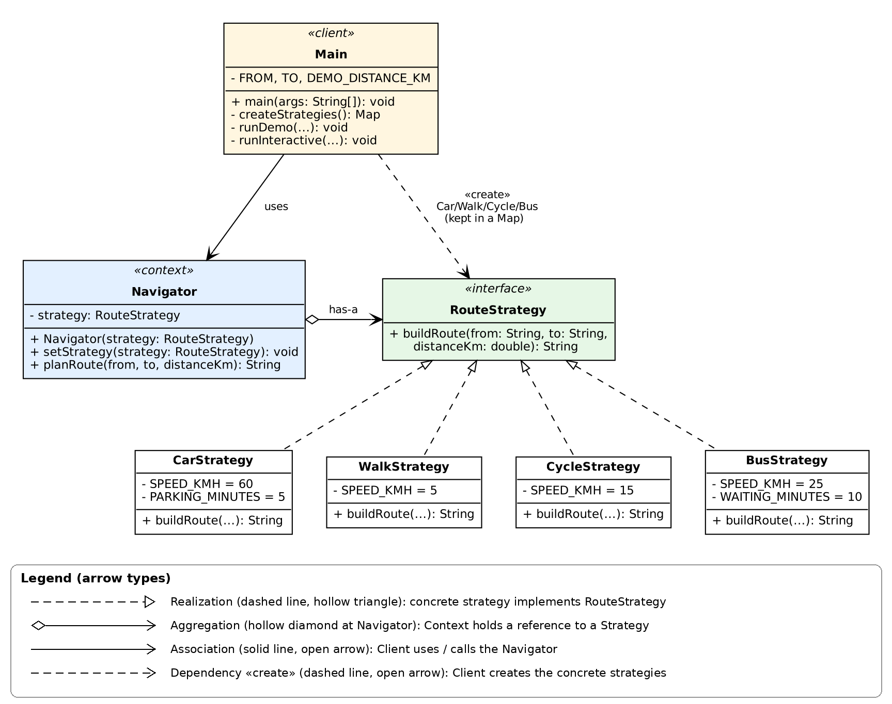
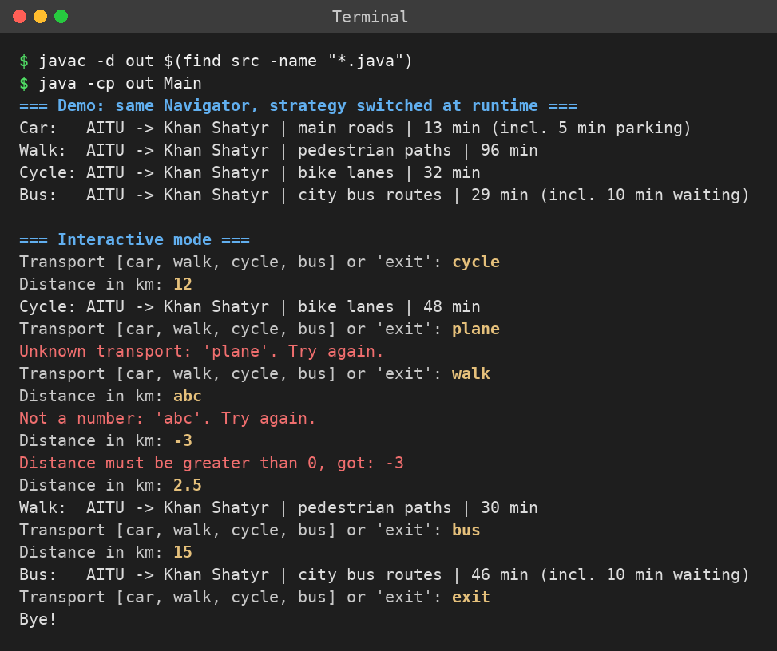

# Assignment 5 — Strategy Pattern (Navigator)

Course: ShP-2216 Software Design Patterns, AITU  
Student: Yussupov Nurlan, group SE-2526

A `Navigator` plans a route from A to B. **How** the route is built (car, walk, cycle, bus)
is a separate *strategy* that can be switched while the program is running.

## Structure

```
src/
├── Main.java                 # Client: creates strategies, switches them at runtime
├── context/
│   └── Navigator.java        # Context: holds a RouteStrategy and delegates to it
└── strategy/
    ├── RouteStrategy.java    # Strategy interface: buildRoute(from, to, distanceKm)
    ├── CarStrategy.java      # 60 km/h + 5 min parking
    ├── WalkStrategy.java     # 5 km/h
    ├── CycleStrategy.java    # 15 km/h
    └── BusStrategy.java      # 25 km/h + 10 min waiting
docs/
├── uml.png                   # UML class diagram (with arrow legend)
└── demo.png                  # screenshot of a real run
```

## UML class diagram



## How to build and run

Requires JDK 17 or newer. From the project folder:

**Windows (PowerShell / cmd):**
```
javac -d out src\Main.java src\context\*.java src\strategy\*.java
java -cp out Main
```

**Linux / macOS:**
```
javac -d out $(find src -name "*.java")
java -cp out Main
```

In IntelliJ IDEA: mark `src` as *Sources Root* and run `Main`.

The program first runs a demo (one `Navigator`, strategy changed at runtime for every mode),
then an interactive mode: type a transport (`car`, `walk`, `cycle`, `bus`), then a distance in km.
Wrong transport names and wrong distances (text, 0, negative) are reported and asked again.
Type `exit` to quit.



## How to add a new strategy

1. Create a class in `src/strategy/` that implements `RouteStrategy`:
   ```java
   public class TaxiStrategy implements RouteStrategy {
       @Override
       public String buildRoute(String from, String to, double distanceKm) { ... }
   }
   ```
2. Register it with one line in `Main.createStrategies()`:
   ```java
   strategies.put("taxi", new TaxiStrategy());
   ```

`Navigator` and the other strategies do not change (Open/Closed principle).
`BusStrategy` was added exactly this way — see its commit in the history.
